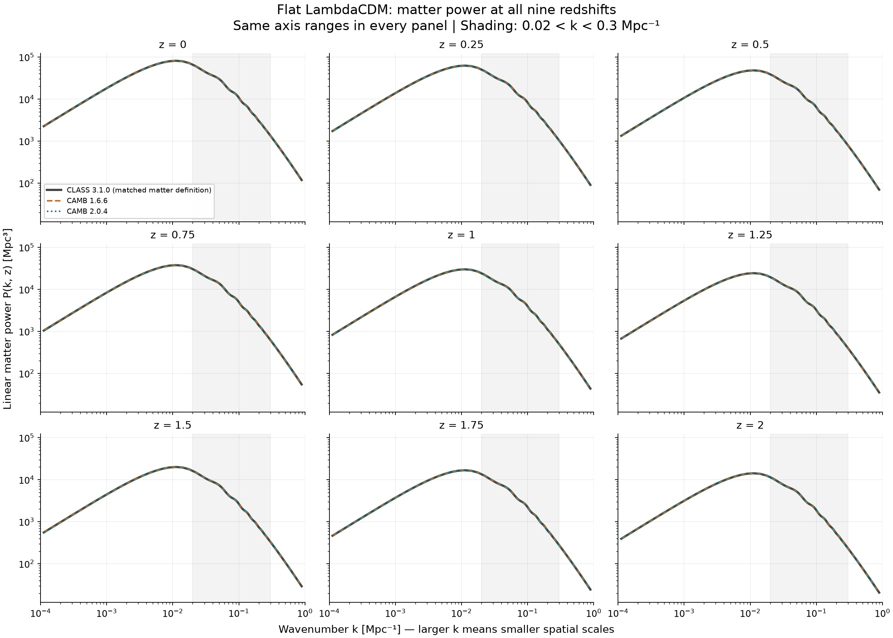
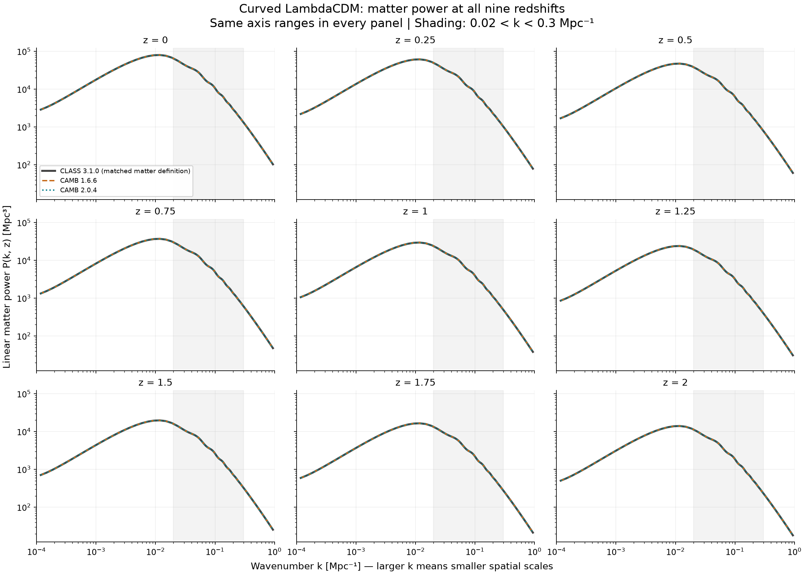
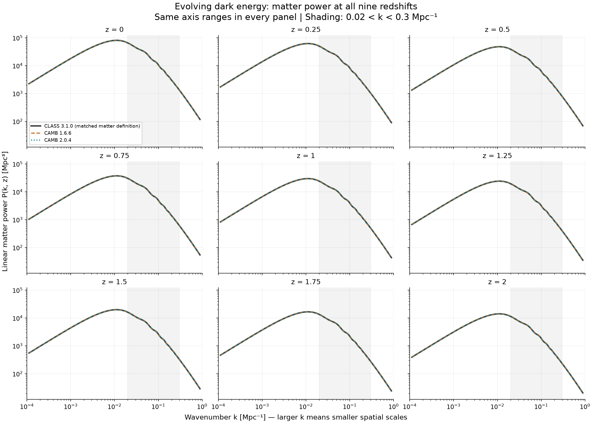

# Comparing CAMB and CAMB2 with CLASS from z=0 to z=2

Before moving on to the emulator, I wanted to see how closely CAMB 1.6.6 and
CAMB 2.0.4 agree with CLASS 3.1.0 when they receive the same cosmological inputs.
I started with three models at z=0, then extended the comparison to nine
redshifts between z=0 and z=2.

**CAMB2 has smaller maximum and RMS differences from CLASS in all 27 tested
model–redshift combinations**, within 0.02 < k < 0.3 Mpc^-1. This is a result
about agreement with CLASS. It does not establish which solver is closest to
an exact solution.

## What I compared

The comparison uses the linear matter power spectrum, P(k), which describes
the strength of matter-density fluctuations at different spatial scales.
Linear theory treats those fluctuations as small. The calculations use this
approximation throughout, including on scales where real clustering would
require nonlinear physics.

I used three models based on the examples in Emmanuel's Figure 4.3: a flat
universe with a cosmological constant, a curved universe with a cosmological
constant, and a flat universe with evolving dark energy. His figure compares
an emulator with CAMB; this work compares the solvers themselves. I have not
yet reproduced or trained the emulator.

The settings come from the thesis where they are documented. Where the exact
inputs are missing, I have recorded the choices made here in the
[source audit](../../02_shared_inputs_and_z0_reference/Source%20audit.md).
The comparison therefore follows his examples, but is not an exact reproduction.

The original z=0 results were kept and checked against a backup. Adding eight
redshifts for each model required **216 new solver runs**, with three repeats
per solver and case, in addition to the 27 runs already completed at z=0.
Together, these give 27 model–redshift combinations and 81 distinct spectra.

## Inputs and method

### Common inputs

To make the comparison useful, each solver needs to calculate the same
physical quantity for the same cosmology. I kept the matter densities,
present expansion rate and primordial fluctuation settings fixed across
the three models, and gave all three solvers the same stated inputs within
each model.

The comparison now covers **z=0, 0.25, 0.5, 0.75, 1, 1.25, 1.5, 1.75 and 2**.
Here z=0 is today, and higher redshift means an earlier time in the same
cosmology. These redshifts are listed in Emmanuel's Chapter 5, Tables 5.1–5.3.
Combining them with the three Figure 4.3 models is the test design used here.

All cases have zero massive neutrinos. Massless neutrinos still contribute
to the radiation density. The common inputs are:

- **H0=67.36 km/s/Mpc:** the present expansion rate.
- **omega_b=0.0224 and omega_cdm=0.120:** the physical baryon and cold-dark-matter
  densities, where omega=Omega × h² and h=H0/100.
- **As=2.1e-9 and ns=0.9649:** the primordial fluctuation amplitude and spectral tilt.
- **tau=0.0544:** the optical depth associated with reionization.
- **TCMB=2.7255 K, Neff=3.044 and YHe=0.245:** the CMB temperature, effective
  number describing neutrino radiation, and helium mass fraction.
- **pivot=0.05 Mpc^-1:** the reference scale for the primordial amplitude and tilt.

### Changes between the models

The curved model changes Omega_k, the spatial curvature parameter. The
evolving-dark-energy model changes w0 and wa, which describe the relation
between dark energy's pressure and density and how it changes with time.

| Model | Omega_k | w0 | wa |
|---|---:|---:|---:|
| Flat LambdaCDM | 0 | -1 | 0 |
| Curved LambdaCDM | 0.01 | -1 | 0 |
| Evolving dark energy | 0 | -0.99 | -0.02 |

For evolving dark energy, I used w(a)=w0+wa(1-a), where a is the scale factor
and equals 1 today. With these values, w crosses -1 at a=0.5, or z=1. CAMB
and CLASS both use PPF, a treatment of dark-energy perturbations that handles
this crossing. The settings are CAMB PPF and CLASS use_ppf=yes, with cs2=1
and c_gamma/c_s=0.4. CLASS calls the time-dependence option CLP; it is the
CPL form written above. Its separate cosmological-constant component is set
to zero for this model, with the evolving component supplying the dark-energy
density. The saved CLASS history of w and present-day densities was checked.

The present dark-energy density is calculated from the expansion equation.
When curvature changes while H0 and the matter densities stay fixed, the
dark-energy density adjusts accordingly.

### Matching the outputs

I matched the units and the definition of matter fluctuations before comparing
the spectra. The matter spectrum here includes baryons and cold dark matter.
CAMB and CLASS can express their density fluctuations using different
coordinate conventions, called gauges, so their outputs need to be matched.

I used CLASS's component outputs to reconstruct the same synchronous-gauge
matter quantity used by CAMB. As a consistency check, those components were
also combined using CLASS's original convention to recover its own power
spectrum. At earlier redshifts, this check uses the expansion rate at that
epoch. This tests the conversion and normalization.

CLASS is called through CosmoBolognaLib's Table_PkCodes interface, which
returns its original output table. I kept CLASS's native k points and asked
CAMB for its predictions at those points. This avoids the extra interpolation
in CBL's higher-level Pk_matter method. CAMB still uses its own interpolation
to return values at the requested points. No sigma8 rescaling was applied;
sigma8 is a measure of the fluctuation amplitude.

### Scales and solver settings

The wavenumber k labels spatial scale: larger k corresponds to smaller scales.
The saved comparison covers **1e-4 <= k <= 1 Mpc^-1**, with both solvers asked
to calculate through k=2 Mpc^-1.

The main figure uses **0.02 < k < 0.3 Mpc^-1**, the interval used in the earlier
comparisons. This is only part of Emmanuel's k range. Using linear predictions
here does not mean that all these scales can be treated linearly in observations.

Each solver keeps its native numerical settings and recombination treatment.
Recombination is the early period when electrons and nuclei formed neutral
atoms, and its treatment can affect P(k). The differences measured here
therefore include these choices as well as numerical effects.

## What I found

At each sampled scale, I calculated:

**Difference (%) = 100 × (P_CAMB / P_CLASS − 1).**

Positive values mean CAMB predicts more power than CLASS; negative values
mean less. I summarize the differences with the largest absolute value and
RMS, or root mean square. RMS squares the differences before averaging and
taking the square root, so positive and negative values do not cancel.
Both quantities are percentages, not uncertainty estimates.

### Agreement across redshifts

Each column below is a cosmology. The top row shows the largest sampled
difference in the chosen k interval, and the bottom row shows RMS. Orange
is CAMB 1.6.6 and teal is CAMB 2.0.4. Each point is one calculated redshift;
the connecting lines are guides to the eye.

**CAMB2 stays closer to CLASS by both measures at every redshift tested.**
The differences change relatively little between z=0 and z=2, so the pattern
seen at z=0 also holds at the earlier times sampled here.

These are the largest differences in 0.02 < k < 0.3 Mpc^-1 across all nine
redshifts. All six occur at z=2.

| Model | CAMB 1.6.6 maximum | z at maximum | CAMB 2.0.4 maximum | z at maximum |
|---|---:|---:|---:|---:|
| Flat LambdaCDM | 0.140297% | 2 | 0.069197% | 2 |
| Curved LambdaCDM | 0.159183% | 2 | 0.065888% | 2 |
| Evolving dark energy | 0.140659% | 2 | 0.068325% | 2 |

### The power spectra

The next plots show P(k) itself, with one panel per redshift. Grey solid is
CLASS, orange dashed is CAMB 1.6.6, and teal dotted is CAMB 2.0.4. All panels
use the same axis ranges. The horizontal axis is k in Mpc^-1 and the vertical
axis is P(k, z) in Mpc³; both are logarithmic. The grey band marks the k
interval used in the main comparison.

The three curves nearly overlap because their differences are small compared
with the range of P(k) shown. The disagreement figure above is better suited
to seeing those small differences. Lines join the saved points; no extra k
values were calculated for these plots.

Within each model, the power is generally lower at higher redshift. This is
consistent with matter fluctuations having had less time to grow. It describes
the evolution of the spectrum, rather than a change in solver error.

#### Flat LambdaCDM

#### Curved LambdaCDM

#### Evolving dark energy

### Values at each redshift

The tables below give the values behind the main figure. All maxima and RMS
values refer to 0.02 < k < 0.3 Mpc^-1. The z=0 rows are unchanged from the
previous comparison.

#### Flat LambdaCDM

| z | Original CLASS focus points | CAMB 1.6.6 maximum | CAMB 2.0.4 maximum | CAMB 1.6.6 RMS | CAMB 2.0.4 RMS |
|---|---:|---:|---:|---:|---:|
| 0 | 63 | 0.136461% | 0.065369% | 0.036083% | 0.029118% |
| 0.25 | 63 | 0.135668% | 0.065362% | 0.036108% | 0.029121% |
| 0.5 | 63 | 0.135881% | 0.065301% | 0.036263% | 0.029097% |
| 0.75 | 63 | 0.136555% | 0.065470% | 0.036412% | 0.029053% |
| 1 | 63 | 0.137009% | 0.065884% | 0.036460% | 0.029038% |
| 1.25 | 63 | 0.138093% | 0.066986% | 0.036541% | 0.029092% |
| 1.5 | 63 | 0.138943% | 0.067842% | 0.036602% | 0.029235% |
| 1.75 | 63 | 0.140043% | 0.068963% | 0.036682% | 0.029369% |
| 2 | 63 | 0.140297% | 0.069197% | 0.036707% | 0.029448% |

#### Curved LambdaCDM

| z | Original CLASS focus points | CAMB 1.6.6 maximum | CAMB 2.0.4 maximum | CAMB 1.6.6 RMS | CAMB 2.0.4 RMS |
|---|---:|---:|---:|---:|---:|
| 0 | 62 | 0.153655% | 0.062971% | 0.038343% | 0.028997% |
| 0.25 | 62 | 0.153999% | 0.062613% | 0.038398% | 0.028999% |
| 0.5 | 62 | 0.155157% | 0.062627% | 0.038508% | 0.028921% |
| 0.75 | 62 | 0.157154% | 0.063181% | 0.038669% | 0.028830% |
| 1 | 62 | 0.157835% | 0.063805% | 0.038712% | 0.028813% |
| 1.25 | 62 | 0.158323% | 0.064794% | 0.038790% | 0.028883% |
| 1.5 | 62 | 0.158834% | 0.065509% | 0.038858% | 0.028947% |
| 1.75 | 62 | 0.159101% | 0.065716% | 0.038880% | 0.028990% |
| 2 | 62 | 0.159183% | 0.065888% | 0.038863% | 0.029007% |

#### Evolving dark energy

| z | Original CLASS focus points | CAMB 1.6.6 maximum | CAMB 2.0.4 maximum | CAMB 1.6.6 RMS | CAMB 2.0.4 RMS |
|---|---:|---:|---:|---:|---:|
| 0 | 63 | 0.138969% | 0.066643% | 0.036508% | 0.029578% |
| 0.25 | 63 | 0.138484% | 0.066152% | 0.036439% | 0.029441% |
| 0.5 | 63 | 0.138027% | 0.065697% | 0.036449% | 0.029376% |
| 0.75 | 63 | 0.138097% | 0.065775% | 0.036447% | 0.029302% |
| 1 | 63 | 0.138043% | 0.065706% | 0.036433% | 0.029265% |
| 1.25 | 63 | 0.138533% | 0.066193% | 0.036406% | 0.029328% |
| 1.5 | 63 | 0.139336% | 0.067002% | 0.036462% | 0.029356% |
| 1.75 | 63 | 0.139772% | 0.067420% | 0.036520% | 0.029368% |
| 2 | 63 | 0.140659% | 0.068325% | 0.036590% | 0.029376% |

### Full sampled k range

Including all sampled points in 1e-4 <= k <= 1 Mpc^-1 gives the following
maxima. The k values are in Mpc^-1. For curved LambdaCDM, CAMB2's largest
difference over this wider range occurs at z=0, outside the narrower interval.

| Model | CAMB 1.6.6 maximum | z | k | CAMB 2.0.4 maximum | z | k |
|---|---:|---:|---:|---:|---:|---:|
| Flat LambdaCDM | 0.140297% | 2 | 0.0383146 | 0.069197% | 2 | 0.0383146 |
| Curved LambdaCDM | 0.159183% | 2 | 0.038894 | 0.066727% | 0 | 0.00936425 |
| Evolving dark energy | 0.140659% | 2 | 0.0383188 | 0.068325% | 2 | 0.0383188 |

## Checks and remaining limits

The checks covered the inputs actually read by the solvers, units, matter
definitions, background densities, spectrum reconstruction and saved file
fingerprints. All repeated spectra matched exactly, and all original z=0
arrays and statistics were recovered unchanged.

This shows that the calculation is repeatable. **A convergence test is still
needed:** repeating the same settings does not tell us whether the result
stays stable when numerical precision is increased.

One small consistency difference appeared at the added redshifts. Reconstructing
CLASS's original power from its component fluctuations differs from the directly
returned power by up to **0.000192%**. The earlier-redshift check allows
**0.001%**, while the tighter z=0 check is unchanged.

CLASS interpolates power and component fluctuations separately in time.
Squaring an interpolated fluctuation need not give exactly the same result as
interpolating its power. The relevant paths were checked in fourier.c
(fourier_pk_at_z) and perturbations.c (perturbations_sources_at_tau). The small
mismatch is consistent with those separate output paths, though it is not a
measurement of CLASS's physical error. The comparison consistently uses the
reconstructed synchronous matter power. The 0.001% threshold is a diagnostic
choice, not a claimed solver accuracy.

The main result should be read within the following limits:

- CLASS is the comparison reference, not an exact solution. Closer agreement
  does not by itself show greater absolute accuracy.
- The maximum and RMS are smaller for CAMB2 in all 27 cases, but CAMB2 need
  not be closer at every individual k. The native recombination choices also
  differ, so pure numerical error has not been isolated.
- Maxima apply to the sampled points. Larger differences could lie between
  them, and the k grids vary slightly between models. RMS gives equal weight
  to each saved point; those points are not evenly spaced in log k.
- Three models and nine redshifts do not cover Emmanuel's full parameter or
  scale range. Emulator validation, effects on inferred parameters, and a
  fair runtime comparison remain outside this experiment. The cause of every
  feature in the differences has not yet been identified.

## Calculation records

The numerical data, unrounded statistics and detailed checks are kept in the
local research workspace, together with the raw runs, scripts and SVG figures.
The tables and PNG plots above are the results shared here for discussion.
