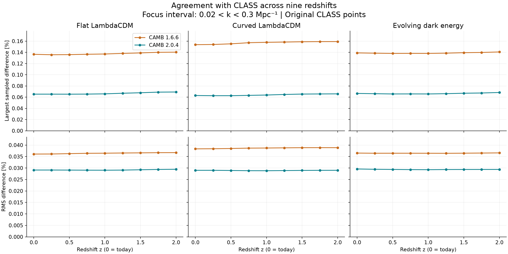

# Weekly update — 29 October 2026

This update covers the comparison of CAMB 2.0.4 with the older 1.6.6 version,
using CLASS as an independent reference.

## What I worked on

Earlier in October, I compared different accuracy settings for CAMB 2.0.4
using a default LambdaCDM model at z=0. I set that comparison aside for now
and shifted my focus to comparing CAMB 2.0.4 and CAMB 1.6.6 with CLASS.
The three solvers agreed closely overall. In the interval
0.02 < k < 0.3 Mpc^-1, CAMB2 had smaller maximum and RMS differences from CLASS.

The three-model comparison at z=0 was completed on 21–22 October. This week I extended
it to **nine redshifts, from z=0 to z=2 in steps of 0.25**, to see whether the
agreement with CLASS changes at earlier times.

I used the same three models: flat LambdaCDM, curved LambdaCDM and evolving
dark energy, all without massive neutrinos. The extension added **216 solver
runs**, including three repeats per added case. The original 27 z=0 runs and
their results were kept unchanged. The repeated spectra matched exactly.

The [full report](../camb-comparison/01_current_solver_comparison/results/Report.md)
now includes the comparison across redshifts and the power spectra for all 27
model–redshift cases. The original z=0 comparison and CBL/CLASS setup were
completed on 21–22 October.

## What the results show

As in the earlier comparison, **CAMB2 has smaller maximum and RMS differences
from CLASS in all 27 cases**,
within 0.02 < k < 0.3 Mpc^-1. The pattern seen at z=0 also holds at the earlier
redshifts tested.

Each column represents one cosmology. The upper row shows the largest sampled
difference, and the lower row shows RMS, which measures the overall size of
the differences. Lower values mean closer agreement with CLASS.

The largest differences across the nine redshifts are:

| Model | CAMB 1.6.6 vs CLASS | CAMB 2.0.4 vs CLASS |
|---|---:|---:|
| Flat LambdaCDM | 0.1403% | 0.0692% |
| Curved LambdaCDM | 0.1592% | 0.0659% |
| Evolving dark energy | 0.1407% | 0.0683% |

All six maximum values occur at z=2. The actual P(k) curves almost overlap, so this
figure is more useful for seeing the small differences between the solvers.

## What this means so far

The comparison gives a consistent result across the three models and nine
redshifts. It is a useful check before the emulator work, but it does not
establish absolute accuracy, since CLASS is a reference for comparison rather
than an exact answer. CAMB2 also is not necessarily closer at every individual k.

I used settings based on Emmanuel's thesis, with the missing choices recorded
in the input notes. The solvers keep their native numerical and recombination
settings. A test with stricter numerical settings is still needed before
claiming convergence. The reported maxima apply only to the sampled k points.

I have not yet reproduced or trained the emulator. Testing its full parameter
range, studying effects on inferred parameters, and making a fair runtime
comparison are still to come.
